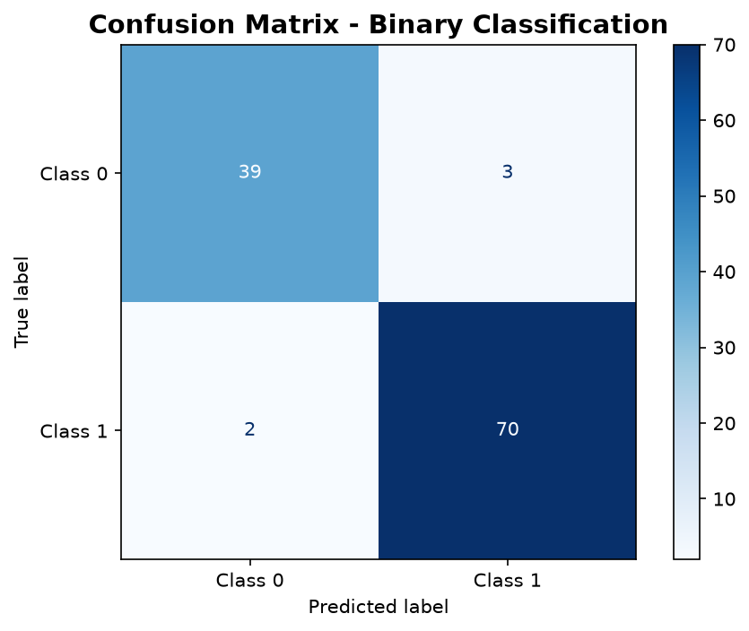
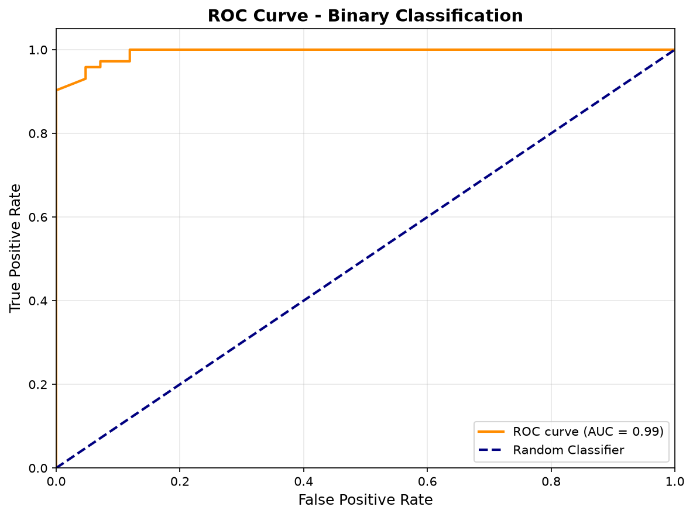
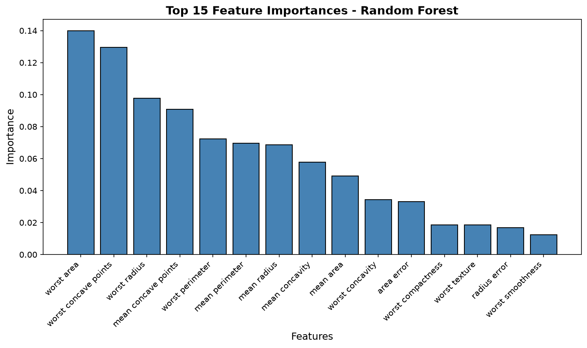

# Binary Classification with Random Forest

A supervised machine learning pipeline demonstrating binary classification using Random Forest on medical diagnostic data, featuring stratified sampling, comprehensive evaluation metrics, feature importance analysis, and model persistence for reproducible inference.

## Overview

This project implements an end-to-end predictive modeling pipeline built in Python. It handles data loading and schema validation, stratified train-test splitting to preserve class proportions, model training using Scikit-Learn's `RandomForestClassifier`, detailed statistical evaluation (accuracy, precision, recall, F1-score, ROC-AUC), metric persistence, automated chart generation, and model serialization via Joblib.

## Features

- **Automated Data Validation**: Checks for required target labels, minimum sample thresholds, missing values, and class balance.
- **Stratified Train-Test Splitting**: 80/20 train-test partition maintaining class distribution across both splits with fixed random seeds (`random_state=42`).
- **Random Forest Classifier**: Multi-core ensemble classification (`n_estimators=100`, `n_jobs=-1`).
- **Comprehensive Evaluation**: Precision, recall, F1-score, overall accuracy, ROC-AUC score, and confusion matrix reporting.
- **Automated Visualization Export**: Generates and saves high-resolution confusion matrix plots, ROC curves, and top-15 feature importance charts.
- **Model & Metric Persistence**: Serializes the trained model to `models/random_forest_classifier.joblib` and exports numerical metrics to `outputs/model_metrics.csv`.

## Tech Stack

- **Language**: Python 3.10+
- **Machine Learning**: Scikit-Learn (`scikit-learn>=1.3.0`)
- **Data Manipulation**: Pandas (`pandas>=2.0.0`), NumPy (`numpy>=1.24.0`)
- **Visualization**: Matplotlib (`matplotlib>=3.7.0`)
- **Model Persistence**: Joblib (`joblib>=1.3.0`)

## Dataset

- **Source File**: `data/dataset.csv` (Breast Cancer Wisconsin Diagnostic dataset structure)
- **Observations**: 569 instances
- **Features**: 30 numerical measurements (mean, standard error, and worst values of cell nucleus characteristics)
- **Target**: Binary classification (`0` = Minority class, `1` = Majority class)
- **Class Distribution**: Class 1: 357 samples (62.74%), Class 0: 212 samples (37.26%)
- **Missing Values**: 0

*Note: For clinical interpretation, domain-specific medical validation is required.*

## Methodology & Results

### Train-Test Partitioning

- **Train Set**: 455 samples (285 Class 1, 170 Class 0)
- **Test Set**: 114 samples (72 Class 1, 42 Class 0)
- **Stratification**: 80/20 ratio with preserved class proportions

### Model Performance (Held-Out Test Set)

| Metric | Value | Interpretation |
|:-------|:------|:---------------|
| **Accuracy** | 95.61% | 109 out of 114 test samples correctly classified |
| **ROC-AUC** | 0.9937 | High discriminatory capacity between classes |

### Classification Report

| Class | Precision | Recall | F1-Score | Support |
|:------|:----------|:-------|:---------|:--------|
| **0** | 0.95 | 0.93 | 0.94 | 42 |
| **1** | 0.96 | 0.97 | 0.97 | 72 |
| **Accuracy** | | | 0.96 | 114 |
| **Macro Avg** | 0.96 | 0.95 | 0.95 | 114 |
| **Weighted Avg** | 0.96 | 0.96 | 0.96 | 114 |

### Confusion Matrix Breakdown

- **True Negatives (TN)**: 39
- **False Positives (FP)**: 3
- **False Negatives (FN)**: 2
- **True Positives (TP)**: 70

## Visualizations

### Confusion Matrix


### Receiver Operating Characteristic (ROC) Curve


### Feature Importance


## Project Structure

```
Predictive-Modeling-Using-Machine-Learning/
├── .gitignore
├── LICENSE
├── README.md
├── requirements.txt
├── main.py
├── data/
│   └── dataset.csv
├── models/
│   └── random_forest_classifier.joblib
└── outputs/
    ├── confusion_matrix.png
    ├── feature_importance.png
    ├── model_metrics.csv
    └── roc_curve.png
```

## Prerequisites

- Python 3.10, 3.11, or 3.12
- `pip` package manager
- Virtual environment tool (`venv`)

## Installation

1. **Clone the repository:**
   ```bash
   git clone https://github.com/nfsprogramming/Predictive-Modeling-Using-Machine-Learning.git
   cd Predictive-Modeling-Using-Machine-Learning
   ```

2. **Create and activate a virtual environment:**

   On Windows (PowerShell):
   ```powershell
   python -m venv .venv
   .venv\Scripts\Activate.ps1
   ```

   On Windows (Command Prompt):
   ```cmd
   python -m venv .venv
   .venv\Scripts\activate.bat
   ```

   On Linux / macOS:
   ```bash
   python3 -m venv .venv
   source .venv/bin/activate
   ```

3. **Install dependencies:**
   ```bash
   pip install -r requirements.txt
   ```

## Usage

Run the end-to-end pipeline:

```bash
python main.py
```

The script executes:
1. Directory path resolution and automatic folder initialization.
2. Dataset loading and structure/data sanity checks.
3. Feature and target separation with stratified train-test splitting.
4. Model fitting via `RandomForestClassifier`.
5. Inference on held-out test data and metric computation.
6. Plot generation and export to `outputs/`.
7. Model artifact serialization to `models/random_forest_classifier.joblib`.
8. Summary metrics export to `outputs/model_metrics.csv`.

## Verification & Testing

Verify pipeline execution and syntax validation:

```bash
python -m py_compile main.py
python main.py
```

Verify output artifacts exist:
- Model: `models/random_forest_classifier.joblib`
- Metrics: `outputs/model_metrics.csv`
- Figures: `outputs/confusion_matrix.png`, `outputs/roc_curve.png`, `outputs/feature_importance.png`

## Limitations

- **Single Held-Out Split**: Evaluation is performed on a single 80/20 split; k-fold cross-validation is recommended for robust variance estimation.
- **Fixed Hyperparameters**: Default Random Forest parameters (`n_estimators=100`) are used without hyperparameter grid search or Bayesian optimization.
- **No Feature Selection**: All 30 input features are used without pruning collinear or redundant variables.
- **Not for Clinical Diagnosis**: The pipeline is designed for statistical demonstration and educational portfolio purposes; it is not approved for clinical diagnostic workflows.

## Contributing

Contributions and suggestions are welcome. Please open an issue or submit a pull request with details on proposed improvements or bug fixes.

## License

This project is licensed under the MIT License - see the [LICENSE](LICENSE) file for details.
